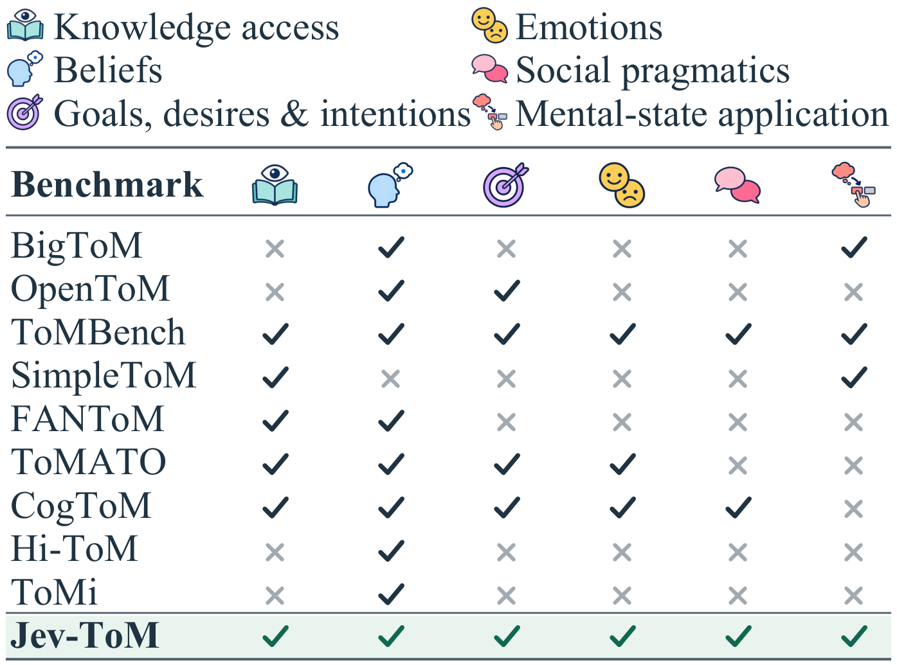
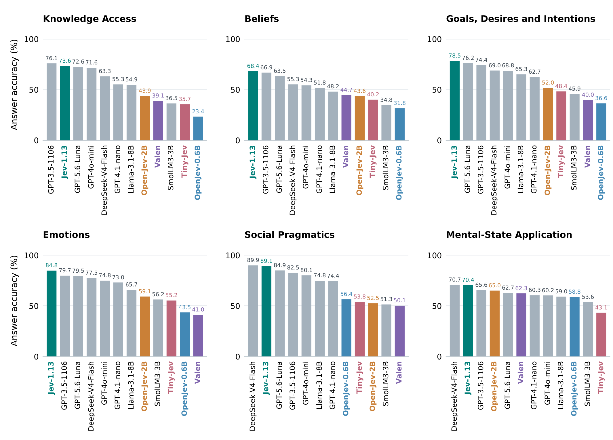

# Jev-ToM

**Jev-ToM: Evaluating Theory of Mind in Typed Decision Models**

Jev-ToM evaluates whether typed decision models can select among interpretations of a person's knowledge, beliefs, intentions and emotions. The study compares five typed models with seven generative baselines on nine Theory of Mind benchmarks, then examines confidence, supplied reasons, output validity and related decisions.

This is the local repository prepared on **13 October 2026**. It packages the frozen questions, answer keys, reason materials and saved results described below. No public repository or arXiv record is claimed here.

[Quick start](#quick-start) · [Results](#benchmark-performance) · [Data](docs/DATASETS.md) · [Models](models/README.md) · [Reproducibility](docs/REPRODUCIBILITY.md) · [Source terms](notices/README.md)

## Benchmark summary

| Property | Scope |
| --- | --- |
| Primary questions | 11,117 English text questions |
| Source benchmarks | BigToM, OpenToM, ToMBench, SimpleToM, FANToM, ToMATO, CogToM, Hi-ToM and ToMi |
| Capability groups | Knowledge access, beliefs, goals/desires/intentions, emotions, social pragmatics and mental-state application |
| Primary models | 5 typed decision models and 7 generative baselines |
| Primary saved outcomes | 133,404 model/question outcomes |
| Extended reason materials | 4,761 accepted materials on existing primary questions |
| Extended condition/order questions | 38,088 |
| Six-condition intervention | 25,704 variants, including 21,636 variants from 1,803 retained materials |
| Additional feedback study | 800 native questions in 400 pairs, with 10,000 saved outcomes from 5 typed models |



The capability groups organize attribution and application questions, with unequal coverage across sources. These are evaluated source subsets, rather than the complete releases of all nine benchmarks. Models, populations and scoring targets for follow-up studies remain separate.

## Evaluation workflow

1. Preserve each frozen source question's context, question, candidate strings and candidate order.
2. Map eligible questions to six capability groups using the versioned mapping in the release.
3. Evaluate selections under strict output requirements, counting invalid responses as wrong.
4. Aggregate within each benchmark, then give the nine benchmarks equal weight.
5. Use separately scoped confidence, reason and feedback studies to examine when selections change.

Supplied reasons are gold-informed option-distraction interventions. Machine review does not establish independent human validation, and newly prepared reasons are for existing questions rather than an unseen test set. Agent integration remains a proposed application.

## Quick start

Use **Python 3.10+**. All supplied tools use the standard library and run offline.

Verify the files and replay the distributed primary and feedback scores:

```sh
python3 tools/verify_release.py
```

Score the saved Jev primary predictions:

```sh
python3 tools/score_primary.py --predictions results/primary_predictions/jev.jsonl.gz
```

Use the same scoring command with another model's prediction file or your own parsed choices. The scorer requires all 11,117 primary IDs and preserves the original denominator. See [reproduction scope and prediction format](docs/REPRODUCIBILITY.md).

Inspect one question with its separately stored answer key using the example in [the data schema](docs/SCHEMA.md), or open the [complete reason-pair example](examples/reason_pair_example.json), which shows four conditions and both orders.

## Benchmark performance

Strict exact-match accuracy (%), on 11,117 questions per model. Invalid responses count as wrong. Overall gives each benchmark equal weight. Rows are grouped by model type and ranked within each group.

| Model | BigToM | OpenToM | ToMBench | SimpleToM | FANToM | ToMATO | CogToM | Hi-ToM | ToMi | Overall |
| --- | --- | --- | --- | --- | --- | --- | --- | --- | --- | --- |
| Jev-1.13 | 89.2 | 60.0 | 76.7 | 59.1 | 79.6 | 83.6 | 81.3 | 59.7 | 69.7 | 73.2 |
| Open-Jev-2B | 80.4 | 45.2 | 51.4 | 49.7 | 71.5 | 50.1 | 49.4 | 39.6 | 72.0 | 56.6 |
| Valen | 74.9 | 38.1 | 46.0 | 75.1 | 48.6 | 32.7 | 39.4 | 33.1 | 57.9 | 49.5 |
| Tiny-Jev | 73.9 | 34.0 | 41.5 | 20.9 | 71.2 | 54.2 | 39.9 | 30.5 | 47.2 | 45.9 |
| OpenJev-0.6B | 74.6 | 39.1 | 40.7 | 56.9 | 29.1 | 20.0 | 42.5 | 31.8 | 53.9 | 43.2 |
| GPT-3.5-1106 | 86.9 | 61.8 | 75.1 | 55.2 | 77.6 | 81.6 | 78.1 | 55.8 | 72.4 | 71.6 |
| GPT-5.6-Luna | 85.1 | 57.6 | 73.8 | 49.7 | 72.2 | 81.9 | 81.5 | 64.9 | 70.9 | 70.9 |
| GPT-4o-mini | 85.2 | 53.8 | 67.0 | 57.7 | 75.3 | 75.1 | 72.2 | 42.9 | 67.3 | 66.3 |
| DeepSeek-V4-Flash | 84.5 | 60.2 | 70.0 | 67.0 | 61.8 | 66.8 | 77.7 | 41.6 | 59.1 | 65.4 |
| GPT-4.1-nano | 78.1 | 47.8 | 57.5 | 64.1 | 67.5 | 71.8 | 66.5 | 35.1 | 63.4 | 61.3 |
| Llama-3.1-8B | 76.7 | 48.4 | 59.9 | 65.3 | 58.8 | 62.6 | 65.1 | 18.2 | 63.8 | 57.6 |
| SmolLM3-3B | 78.3 | 45.0 | 48.1 | 47.7 | 42.1 | 35.2 | 49.7 | 35.1 | 57.1 | 48.7 |

Exact values and counts: [CSV](results/benchmark_performance.csv), [full benchmark cells](results/primary_by_benchmark.csv), [capability results](results/capability_performance.csv).




Jev has the highest benchmark-equal overall accuracy in this twelve-model primary cohort. The other typed models have different benchmark strengths: for example, Valen leads SimpleToM within the typed group, while Open-Jev-2B has the strongest typed ToMi result. The grouping does not imply that all typed models share one architecture. Model selection occurred after evaluation, and this is not an exhaustive model comparison.

## Data and code

| Path | Contents |
| --- | --- |
| [data/](data/README.md) | Frozen questions, separate source keys, reason materials, candidate-component mappings and feedback prompts |
| [results/](results/README.md) | Twelve-model primary results, saved primary/feedback choices and separately scoped follow-up summary tables |
| [models/](models/README.md) | Canonical model IDs, returned versions, deployment settings and study membership |
| [docs/](docs/REPRODUCIBILITY.md) | Dataset scope, field schema and exact replay coverage |
| [tools/verify_release.py](tools/verify_release.py) | Integrity checks and saved-result replay |
| [tools/score_primary.py](tools/score_primary.py) | Strict exact-match scoring of complete parsed primary choices |
| [examples/](examples/reason_pair_example.json) | A readable reason-pair example |
| [assets/figures/](assets/figures/) | Current manuscript figures used in this README |
| [notices/](notices/README.md) | Archived source notices and license-scope records |
| [manifest.json](manifest.json) | Frozen input hashes, scopes, counts and provenance |
| [SHA256SUMS.json](SHA256SUMS.json) | Integrity hashes for distributed files |

## Reproducibility scope

Primary accuracies and feedback macros can be replayed from the supplied choices and keys. Capability and reason summaries are exact exports of saved results. The package does not include complete per-question reason outputs, confidence probabilities, candidate-load diagnostics, human annotation stages, family-resampling code or full provider attempt journals. It is not a model-serving environment. The [reproducibility guide](docs/REPRODUCIBILITY.md) distinguishes supplied replay from the broader planned release inventory.

The original data-export manifest remains dated 10 October 2026. Local repository preparation retains those frozen data and scores, while adding documentation, figure previews and a standalone scorer.

## Data and license notice

The authors' original releasable contributions use [CC BY 4.0](LICENSE.md). Original benchmark questions, contexts, candidate answers, answer keys and model assets retain their own terms. The source notices preserve noncommercial and evaluation-only restrictions where recorded. Consult [the source-by-source records](notices/README.md) before use or redistribution.

Repository organization was informed by [HKUST-KnowComp/MultivationBench](https://github.com/HKUST-KnowComp/MultivationBench), especially its benchmark overview, data guide, executable quick start and source-license separation. The content and results here concern Jev-ToM.
